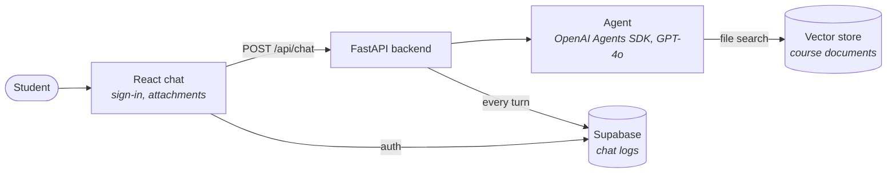

# pie-insignia-agent

AI tutor for the ISST course at ETSI de Telecomunicación (Universidad Politécnica de
Madrid), built in 2025 for the Insignia educational innovation project. Students ask about
the course in a chat, and the agent answers only from the official course documents and
names the document it took each answer from.

I designed the agent and built the whole application: backend, frontend, database and
the tooling that loads the course material. The original repository is
[STRAST-UPM/pie-insignia-agent](https://github.com/STRAST-UPM/pie-insignia-agent).

## How it works



- **Agent.** One agent built with the OpenAI Agents SDK. Its only tool is file search
  over a vector store that holds the course PDFs, so retrieval is its single source of
  course knowledge.
- **Tutor behaviour.** The system prompt (`app/backend/system_prompt.txt`, in Spanish)
  restricts answers to the official documents, asks the agent to name the document and
  section behind each explanation, and to say so when the documents do not cover a
  question. It also sets the teaching style: find out what the student already knows,
  explain in small steps and check understanding before moving on.
- **Attachments.** A student can attach PDFs and images to a question. PDF text is
  extracted with pypdf and added to the message; images go to the model as they are.
- **Conversations.** The backend keeps the history of each session and replays it on
  every turn. Each question and answer is also written to a `chat_logs` table in
  Supabase.
- **Sign-in.** The frontend uses Supabase Auth with Google and GitHub.

## Stack

| Part | Technology |
|---|---|
| Agent | OpenAI Agents SDK, GPT-4o, file search on an OpenAI vector store |
| Backend | Python, FastAPI, Pydantic settings, pypdf |
| Frontend | React 18, TypeScript, Vite, Tailwind CSS, react-markdown |
| Data and auth | Supabase (PostgreSQL, Auth, row-level security) |

## Run it

Requirements: Python 3.9+, Node.js 18+, an OpenAI API key and a Supabase project.

**1. Load the course documents.** Put the PDFs in `manage-vector-store/files/` and create
the vector store:

```bash
cd manage-vector-store
pip install -r requirements.txt
cp .env.example .env                       # fill in OPENAI_API_KEY
python vector_manager.py setup files "ISST materials"
```

`python vector_manager.py list-stores` then shows the ID of the new store, which the
backend needs. The same tool uploads and deletes files and stores; run it with `--help`
for the full list.

**2. Create the database.** Run `app/supabase/migrations/20250522092836_create_chat_logs_table.sql`
in the SQL editor of the Supabase project, and enable the Google and GitHub providers in
its authentication settings.

**3. Start the backend.**

```bash
cd app/backend
python -m venv venv && source venv/bin/activate   # Windows: venv\Scripts\activate
pip install -r requirements.txt
cp .env.example .env                               # OpenAI key, vector store ID, Supabase keys
python start.py                                    # http://localhost:8000
```

`python start.py --verify` also checks that the OpenAI API and the vector store are
reachable before starting.

**4. Start the frontend.**

```bash
cd app/frontend
npm install
cp .env.example .env                               # Supabase URL and anon key
npm run dev
```

## API

**`POST /api/chat`** takes a multipart form:

| Field | Content |
|---|---|
| `pregunta` | The question (may be empty if files are attached) |
| `session_id` | Optional; reuse it to continue a conversation |
| `files` | Optional PDFs or images (`jpg`, `png`, `gif`, `webp`) |

```bash
curl -X POST http://localhost:8000/api/chat \
  -F "pregunta=¿Qué es un caso de uso?" \
  -F "session_id=demo"
```

```json
{ "respuesta": "...", "session_id": "demo" }
```

**`GET /api/health`** returns the service status.

## Project structure

```
app/
├── backend/               # FastAPI service and agent
│   ├── app.py             # endpoints, attachment handling, agent setup
│   ├── config.py          # typed settings read from .env
│   ├── start.py           # start-up checks, then uvicorn
│   └── system_prompt.txt  # tutor instructions
├── frontend/              # React and TypeScript chat
└── supabase/migrations/   # chat_logs table and its policies
manage-vector-store/       # CLI to upload documents and manage vector stores
```

## Limitations

What I would change before putting this in front of more students:

- **History lives in memory.** Conversations are replayed from a dictionary in the
  backend process, so they are lost on restart and a second worker would not see them.
- **The API trusts the session ID.** `/api/chat` does not verify the signed-in user, so
  the session ID works as identifier and credential at once.
- **Chat logs are readable with the public key.** The migration lets anonymous clients
  read `chat_logs`; reads should be limited to staff.
- **No automated tests.** Answers were evaluated against a fixed set of test questions,
  outside this repository.
